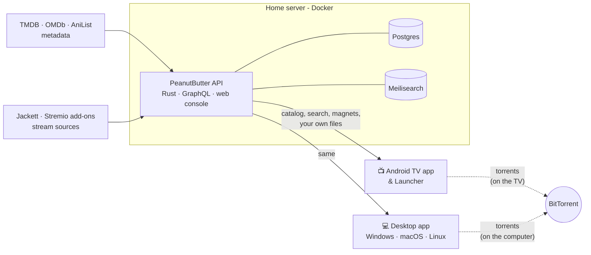

# 🥜 PeanutButter

**Your own streaming service.** Run one small server at home, then browse and watch from your TV, laptop or desktop with apps that feel like the big streaming services, without the subscriptions or the tracking.

[](https://github.com/PeanutButterOrg/PeanutButter/actions/workflows/desktop-builds.yml)
[](https://github.com/PeanutButterOrg/PeanutButter/actions/workflows/backend-docker.yml)
[](https://github.com/PeanutButterOrg/PeanutButter/releases/latest)

| | |
|---|---|
| 📺 **Android TV** | A native app built for the remote, or swap your whole TV Home screen for the **PeanutButter Launcher** |
| 💻 **Desktop** | Windows, macOS and Linux |
| 🖥️ **Server** | One Docker Compose file: catalog, search, pairing and a web console |

---

## What it does

**Browse like a streaming app**
- A catalog of movies and series with posters, trailers, cast, genres, and TMDB, IMDb and Rotten Tomatoes scores
- Trending, Popular and Recently added rows, each title marked with the streaming services that carry it
- Fast, typo-tolerant search, plus filters for genre, year, rating and streaming service
- Titles and descriptions always in English, even for shows from other countries

**Watch without friction**
- Continue watching, favourites and watched marks
- **Skip intro / credits** and **Play next** with a countdown
- Subtitles from OpenSubtitles or Wyzie, or your own `.srt` / `.vtt` file or link
- **Follow a series** to get an alert when a new episode airs

**Your sources**
- Plays files from your own media folder, with instant seeking
- Finds streams through [Jackett](https://github.com/Jackett/Jackett) and Stremio add-ons. Torrents download **on the device that plays them**, never on the server.

**Easy to live with**
- Pair a TV or computer with a **6-digit code** from the console. The app can find the server on your network by itself.
- Apps update themselves from your server, and every update is signature-checked
- The server can update itself from the console, backing up the database first

---

## How it fits together



The server is the brain: metadata, search, sources, pairing and updates. The apps do the playing. Files from your media folder stream from the server with byte-range seeking. Torrents are downloaded by the app itself (libtorrent), so the server never stores or shares them.

---

## Get started in 3 steps

**1. Start the server** on any Linux machine with Docker:

```bash
git clone https://github.com/PeanutButterOrg/PeanutButter.git
cd PeanutButter
# Set PUBLIC_URL in docker-compose.server.yml to the address your apps will use,
# e.g. http://192.168.1.10:3001
docker compose -f docker-compose.server.yml up -d
curl http://127.0.0.1:3001/health
```

On CasaOS / ZimaOS, use `docker-compose.casaos.yml`. For every option, see the **[server install guide](docs/SERVER.md)**.

**2. Open the console** at `http://YOUR_SERVER:3001/`.
- Sign in. If you didn't set `ADMIN_PASSWORD`, the generated password is printed in the server log: `docker compose -f docker-compose.server.yml logs api`.
- Add a TMDB key (free) so the catalog fills up.
- Optionally, set up Jackett or Stremio add-ons under **Streaming**.

**3. Install an app and pair it.**
- Download it from the [latest release](https://github.com/PeanutButterOrg/PeanutButter/releases/latest).
- Create a device code under **Devices** in the console.
- Type the 6-digit code in the app.

| Platform | Download | Player |
|---|---|---|
| Android TV | `PeanutButter-android-tv.apk` (or the `arm64-v8a` / `armeabi-v7a` build for your TV) | ExoPlayer, or LibVLC |
| Android TV Home screen | `PeanutButter-android-tv-launcher.apk` ([what it is](android-native/tv/src/launcher/README.md)) | ExoPlayer, or LibVLC |
| Windows | `PeanutButter-windows-x64-setup.exe` | libmpv |
| macOS | `PeanutButter-macos-universal.zip` (Intel + Apple silicon) | libmpv |
| Linux | `PeanutButter-linux-amd64.deb` or `PeanutButter-linux-x86_64.AppImage` | libmpv |

---

## What's in this repo

| Folder | What | Read more |
|---|---|---|
| [`backend/`](backend/) | The server: Rust, Axum, GraphQL, Postgres, Meilisearch | [backend/README.md](backend/README.md) |
| [`android-native/`](android-native/) | Android TV app and Launcher, in Kotlin | [android-native/README.md](android-native/README.md) |
| [`frontend/`](frontend/) | Desktop app (Flutter) for Windows, macOS and Linux | [frontend/README.md](frontend/README.md) |
| [`docs/`](docs/) | Server install and Docker guides | [SERVER.md](docs/SERVER.md) · [DOCKER.md](docs/DOCKER.md) |
| [`scripts/`](scripts/) | Build, packaging and install helpers | |
| [`packaging/`](packaging/) | Installer configs and the update-signing public key | |

---

## Developing

```bash
# Server: Postgres + Meilisearch in Docker, API on the host
docker compose up -d postgres meilisearch
cp .env.example .env                  # then fill in TMDB_API_KEY etc.
cd backend && cargo run

# Desktop app
cd frontend && flutter pub get && flutter run -d macos   # or linux / windows

# Android TV app and Launcher
cd android-native && ./gradlew :tv:assembleAppDebug :tv:assembleLauncherDebug
./scripts/update-apps.sh --tv         # build and install on a TV over adb
```

Tests: `cd backend && cargo test` · `cd frontend && flutter test` · `cd android-native && ./gradlew :core:testDebugUnitTest`.

### Releasing

Releases are cut by merging, not by hand:

1. In your pull request, bump `version` in `backend/Cargo.toml` (one "Server 0.x.y" commit).
2. Merge it into `main`.
3. The [auto-tag workflow](.github/workflows/auto-tag.yml) tags the merge `v0.x.y` and starts both release builds:
   - **Backend & Docker** publishes `ghcr.io/peanutbutterorg/peanutbutter-api:stable`, `:latest` and `:0.x.y`.
   - **Platform Builds** publishes the signed GitHub Release with every installer.

A PR that doesn't bump the version releases nothing, and CI runs only for release tags. Servers then offer the new apps to every paired device, and the console offers the server update.

---

## Configuration

Everything has a sensible default. Most settings, including API keys, Jackett, add-ons, subtitles and languages, can be changed in the console without a restart.

| Variable | What it does |
|---|---|
| `PUBLIC_URL` | **The address apps use to reach the server** (LAN IP or domain). Set this. |
| `ADMIN_PASSWORD` | First console password. Empty means one is generated and logged. `ADMIN_PASSWORD_RESET=1` forces it once. |
| `TMDB_API_KEY` · `OMDB_API_KEY` · `ANILIST_CLIENT_ID` | Metadata. TMDB is the important one; OMDb adds IMDb and Rotten Tomatoes scores. |
| `MEDIA_PATH` | Your own media folder, mounted into the container |
| `JACKETT_URL` · `JACKETT_API_KEY` | Jackett, if you prefer env vars over the console |
| `OPENSUBTITLES_API_KEY` · `WYZIE_API_KEY` | Subtitle providers |
| `PREFERRED_LANGUAGES` | Audio and subtitle languages to prefer (e.g. `en,hi`) |
| `API_KEY` | A fixed pairing code for the admin device, re-opened for 15 minutes on each boot |
| `CORS_ORIGINS` | Extra browser origins allowed to call the API (comma-separated) |
| `SYNC_CRON_POPULAR` · `SYNC_CRON_STALE` · `SYNC_WORKERS` | Metadata sync schedule and parallelism |
| `UPDATES_ENABLED` · `UPDATE_CHECK_HOURS` | App update mirroring (on by default) |
| `DATABASE_URL` · `MEILI_URL` · `MEILI_MASTER_KEY` | Set by the compose files; change only if you run your own |
| `BIND_ADDR` · `RUST_LOG` | Listen address and log filter |

[`.env.example`](.env.example) is a starting point for local development; [docs/SERVER.md](docs/SERVER.md) covers server-only settings such as auto-update.

---

## Security at a glance

- **Pairing:** a 6-digit code works for 15 minutes and is traded for a long random device key. The server stores only the key's hash. Wrong codes are rate-limited per client and server-wide.
- **Console:** argon2-hashed password, revocable sessions, and refusal of form posts from other sites.
- **Updates:** every app and server release is signed with an Ed25519 key that only CI holds. The server and the apps both check the signature and each file's hash, and never install an older version.
- **Torrents:** never stored on the server. The server won't fetch arbitrary links for clients.
- **Network:** the database, search and updater containers aren't exposed outside Docker. For access from outside your home, put HTTPS in front of port 3001 with a reverse proxy.

---

## Please use it responsibly

PeanutButter is a catalog and player. It ships with no content and no content sources. You decide what goes in your media folder and which sources you connect, so only use content you have the right to watch.

## Credits

Metadata from [TMDB](https://www.themoviedb.org/) (this product uses the TMDB API but is not endorsed or certified by TMDB), IMDb and Rotten Tomatoes scores via [OMDb](https://www.omdbapi.com/), and anime data from [AniList](https://anilist.co/). Intro and credits timings come from [TheIntroDB](https://theintrodb.org/). Playback by [libmpv](https://mpv.io/) / [media_kit](https://github.com/media-kit/media-kit), [ExoPlayer](https://developer.android.com/media/media3) and [LibVLC](https://www.videolan.org/vlc/libvlc.html). Torrents by [libtorrent](https://www.libtorrent.org/).
