<div align="center">

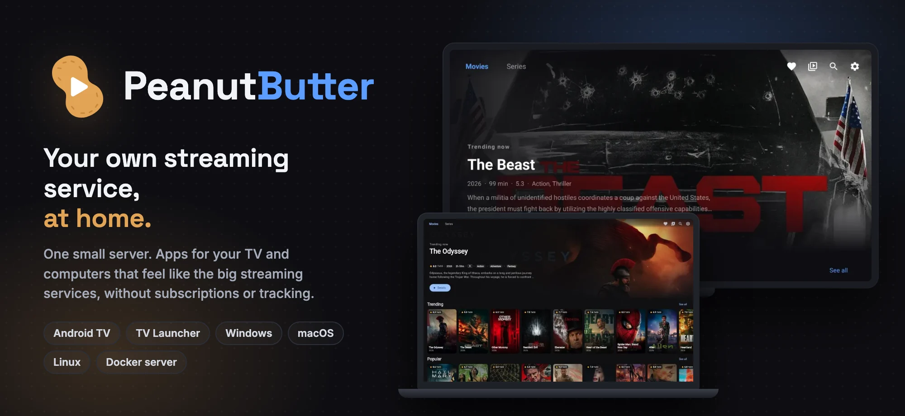

<br>

[](https://github.com/PeanutButterOrg/PeanutButter/releases/latest)
[](https://github.com/PeanutButterOrg/PeanutButter/actions/workflows/desktop-builds.yml)
[](https://github.com/PeanutButterOrg/PeanutButter/actions/workflows/backend-docker.yml)

**[Features](#-what-you-get)** · **[Screenshots](#-a-look-around)** · **[Get started](#-get-started-in-3-steps)** · **[Downloads](#-downloads)** · **[Configuration](#-configuration)** · **[Developing](#-developing)**

</div>

<br>

Run one small server at home, then browse and watch from your **TV, laptop or desktop** with apps that feel like the big streaming services, **without the subscriptions or the tracking**.

<table>
  <tr>
    <td width="33%" valign="top">
      <h3>📺 Android TV</h3>
      A native app built for the remote.
    </td>
    <td width="33%" valign="top">
      <h3>💻 Desktop</h3>
      Windows, macOS and Linux, with full keyboard and mouse control. An optional web build runs in a browser.
    </td>
    <td width="33%" valign="top">
      <h3>🐳 Server</h3>
      One Docker Compose file: catalog, search, sources, pairing, updates and a web console.
    </td>
  </tr>
</table>

---

## ✨ What you get

<table>
  <tr>
    <td width="50%" valign="top">
      <h4>🍿 Browse like a streaming app</h4>
      <ul>
        <li><b>Home</b>, <b>Movies</b>, <b>Series</b> and <b>Explore</b>, the same on every screen: a big trending hero, <b>Top 10 today</b>, Continue watching, Popular and Recently added</li>
        <li>Movies and series with trailers, cast, <b>More like this</b>, and TMDB, IMDb and Rotten Tomatoes scores; only rated titles make the rows</li>
        <li>Fast, typo-tolerant search with the best-rated match on top, and filters for type, genre, year, rating and streaming service that keep pulling new titles from TMDB as you scroll</li>
      </ul>
    </td>
    <td width="50%" valign="top">
      <h4>▶️ Watch without friction</h4>
      <ul>
        <li>Continue watching, <b>My List</b> and watched marks; reopen a title and choose <b>Continue from</b> or <b>Start over</b></li>
        <li><b>Skip intro / credits</b> and <b>Play next</b> with a countdown</li>
        <li>Subtitles from OpenSubtitles or Wyzie, or your own <code>.srt</code> / <code>.vtt</code>, with your choice of size, background and delay</li>
        <li><b>Notify me</b> when a followed series gets a new episode</li>
      </ul>
    </td>
  </tr>
  <tr>
    <td width="50%" valign="top">
      <h4>🎯 Only good copies</h4>
      <ul>
        <li>Sources come from your own media folder, <a href="https://github.com/Jackett/Jackett">Jackett</a> and Stremio add-ons, searched together and ranked</li>
        <li><b>HD only</b>: 720p, 1080p and 4K. Cinema recordings (CAM, telesync, screeners) never show up</li>
        <li>Torrents download <b>on the device that plays them</b>, never on the server</li>
      </ul>
    </td>
    <td width="50%" valign="top">
      <h4>🔒 Easy to live with</h4>
      <ul>
        <li>Pair a TV or computer with a <b>6-digit code</b>; apps find the server on your network by themselves</li>
        <li>Apps update themselves from your server, and every update is signature-checked</li>
        <li>The server updates itself from the console, backing up the database first</li>
      </ul>
    </td>
  </tr>
</table>

---

## 📸 A look around

All screenshots are from real builds with a catalog synced from TMDB. Click any of them to see it full size.

### 📺 Android TV app

Built for the remote: everything works with the arrow keys and OK.

<table>
  <tr>
    <td width="33%" valign="top"><a href="docs/screenshots/tv-home.webp">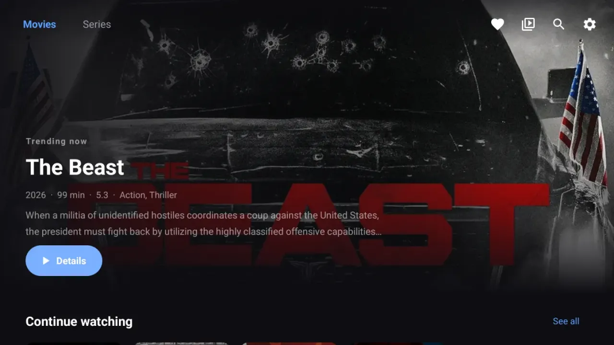</a><br><sub><b>Home</b> · trending hero with Play, My List, More info</sub></td>
    <td width="33%" valign="top"><a href="docs/screenshots/tv-home-rows.webp">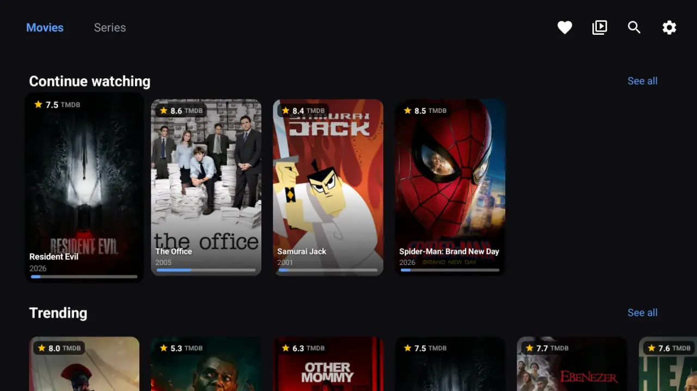</a><br><sub><b>Top 10 today</b>, then Continue watching</sub></td>
    <td width="33%" valign="top"><a href="docs/screenshots/tv-title.webp">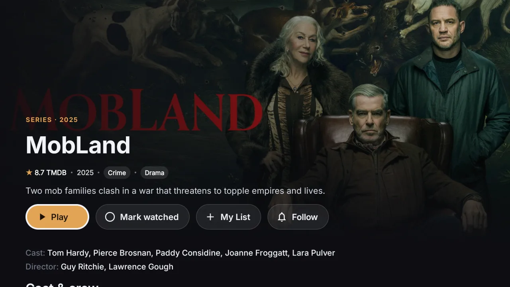</a><br><sub><b>Title page</b> · Play, Mark watched, My List, Follow</sub></td>
  </tr>
  <tr>
    <td width="33%" valign="top"><a href="docs/screenshots/tv-episodes.webp">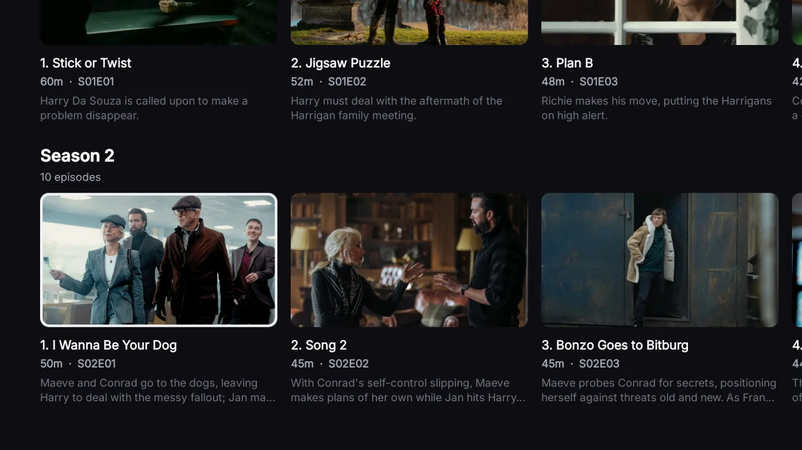</a><br><sub><b>Episodes</b> · stills, runtime and synopsis</sub></td>
    <td width="33%" valign="top"><a href="docs/screenshots/tv-see-all.webp">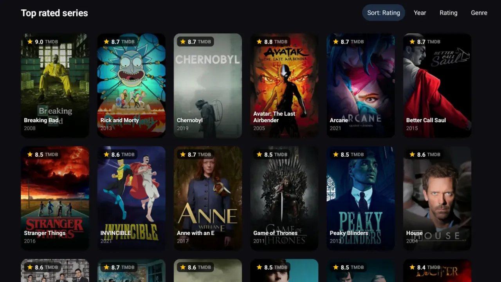</a><br><sub><b>Explore</b> · movies and series, with filters</sub></td>
    <td width="33%" valign="top"><a href="docs/screenshots/tv-search.webp">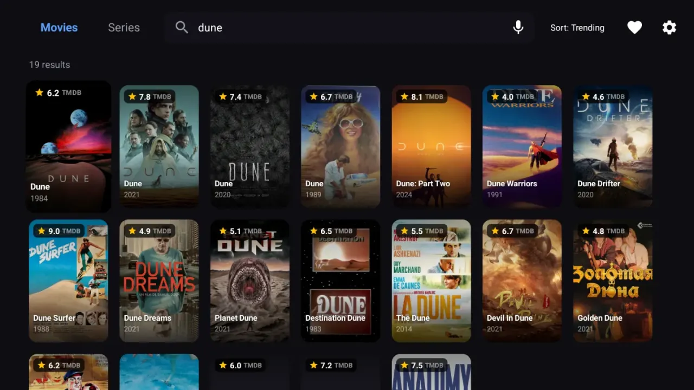</a><br><sub><b>Search</b> · Movies or Series, voice or keyboard</sub></td>
  </tr>
</table>

### 💻 Desktop · Windows, macOS, Linux

Mouse, keyboard or both: rows page with arrows, and the focus ring shows only when you use the keyboard.

<table>
  <tr>
    <td width="33%" valign="top"><a href="docs/screenshots/desktop-home.webp">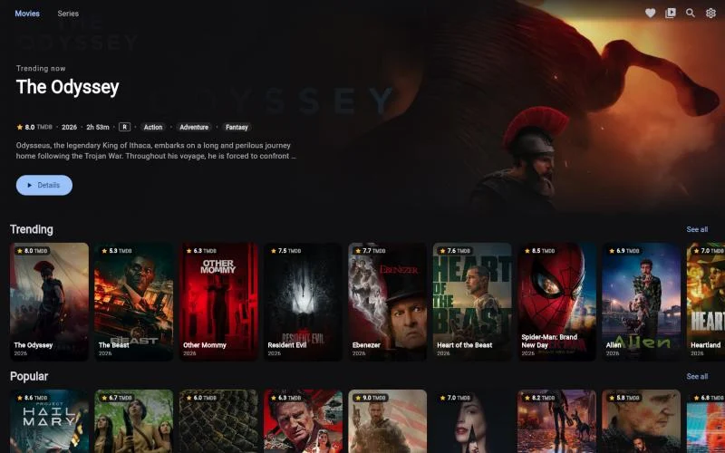</a><br><sub><b>Home</b> · hero and Top 10 today</sub></td>
    <td width="33%" valign="top"><a href="docs/screenshots/desktop-rows.webp">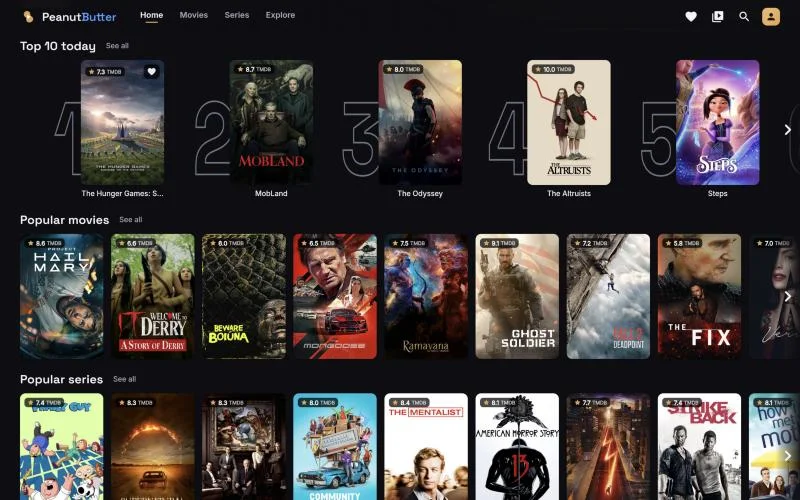</a><br><sub><b>Rows</b> · Top 10, Popular, Recently added</sub></td>
    <td width="33%" valign="top"><a href="docs/screenshots/desktop-title.webp">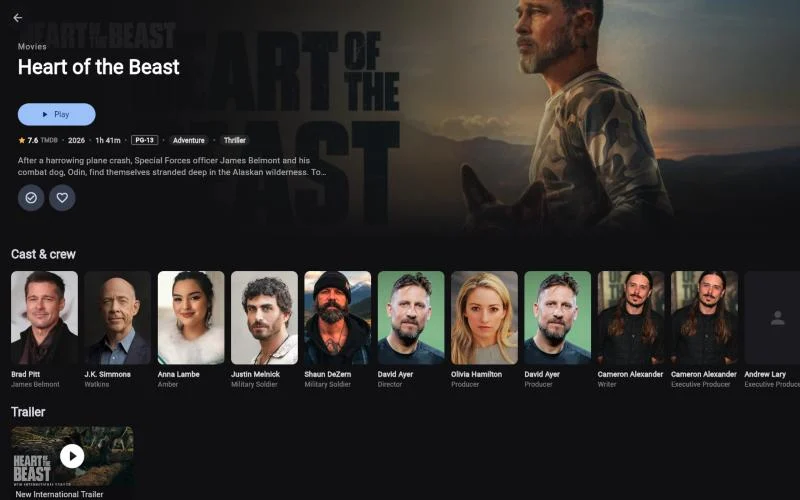</a><br><sub><b>Title page</b> · cast, trailer, More like this</sub></td>
  </tr>
  <tr>
    <td width="33%" valign="top"><a href="docs/screenshots/desktop-episodes.webp">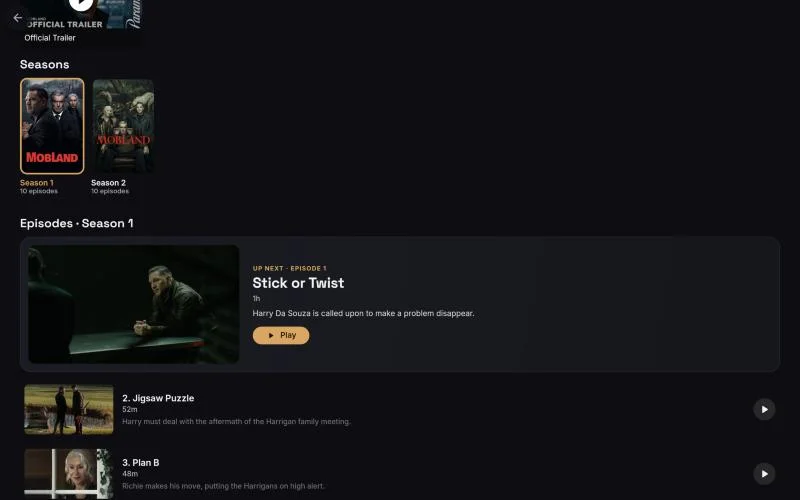</a><br><sub><b>Episodes</b> · seasons and Up next</sub></td>
    <td width="33%" valign="top"><a href="docs/screenshots/desktop-see-all.webp">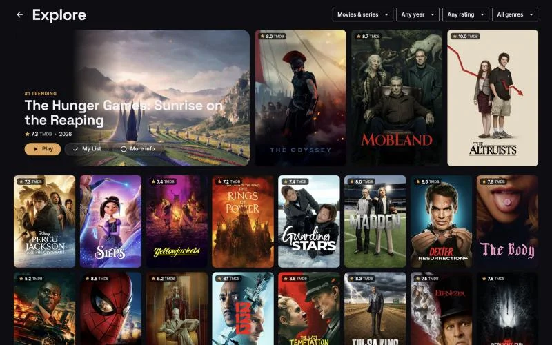</a><br><sub><b>Explore</b> · type, year, rating and genre</sub></td>
    <td width="33%" valign="top"><a href="docs/screenshots/desktop-search.webp">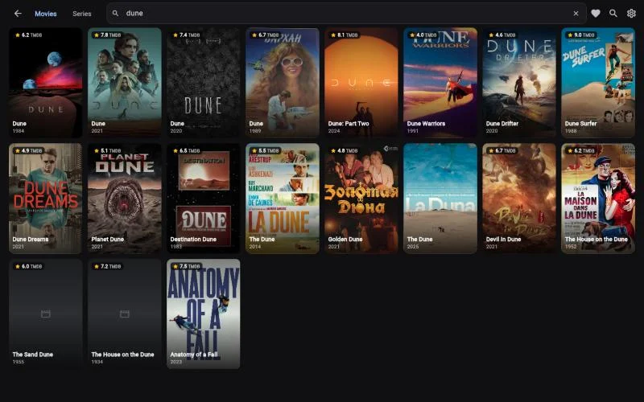</a><br><sub><b>Search</b> · top result first</sub></td>
  </tr>
</table>

---

## 🚀 Get started in 3 steps

### 1 · Start the server

On any Linux machine with Docker:

```bash
git clone https://github.com/PeanutButterOrg/PeanutButter.git
cd PeanutButter
# Set PUBLIC_URL in docker-compose.server.yml to the address your apps will use,
# e.g. http://192.168.1.10:3001
docker compose -f docker-compose.server.yml up -d
curl http://127.0.0.1:3001/health
```

> [!TIP]
> On **CasaOS / ZimaOS**, use `docker-compose.casaos.yml`. Every option is in the **[server install guide](docs/SERVER.md)**.

### 2 · Open the console

Go to `http://YOUR_SERVER:3001/` and sign in.

- No `ADMIN_PASSWORD` set? The generated one is in the log: `docker compose -f docker-compose.server.yml logs api`.
- Under **Settings**, add a free **TMDB key** so the catalog fills up. The **Sync** tab shows it filling.
- Optionally, add Jackett or Stremio add-ons under **Streaming**.

<table>
  <tr>
    <td width="33%" valign="top">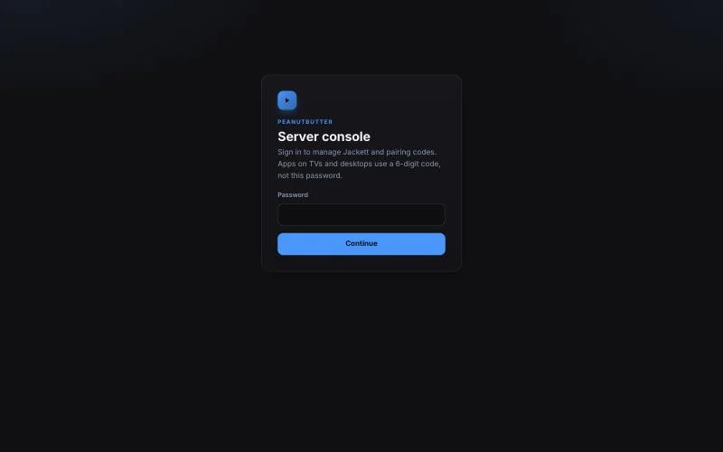<br><sub><b>Sign in</b> with the admin password</sub></td>
    <td width="33%" valign="top">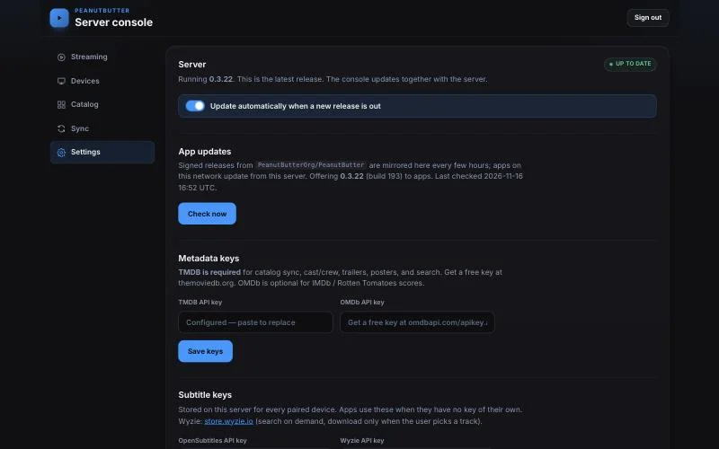<br><sub><b>Settings</b> · updates and API keys</sub></td>
    <td width="33%" valign="top">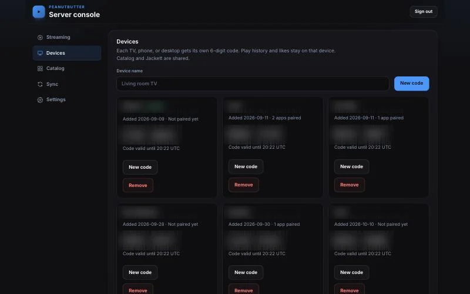<br><sub><b>Devices</b> · one code per TV or computer (blurred here)</sub></td>
  </tr>
</table>

### 3 · Install an app and pair it

1. Download the app for your device from the **[latest release](https://github.com/PeanutButterOrg/PeanutButter/releases/latest)** (see [Downloads](#-downloads)).
2. In the console, open **Devices**, type a name such as *Living room TV*, and choose **New code**.
3. Open the app. It finds the server on your network by itself (or type its address), then enter the **6-digit code** within 15 minutes.

That's it: the app shows your catalog and from now on updates itself from your server.

---

## 📦 Downloads

All from the **[latest release](https://github.com/PeanutButterOrg/PeanutButter/releases/latest)**.

| | Platform | File | Player |
|:-:|---|---|---|
| 📺 | **Android TV** | `PeanutButter-android-tv.apk` (or the `arm64-v8a` / `armeabi-v7a` build for your TV) | ExoPlayer or LibVLC |
| 🪟 | **Windows** | `PeanutButter-windows-x64-setup.exe` | libmpv |
| 🍎 | **macOS** | `PeanutButter-macos-universal.zip` (Intel + Apple silicon) | libmpv |
| 🐧 | **Linux** | `PeanutButter-linux-amd64.deb` or `PeanutButter-linux-x86_64.AppImage` | libmpv |
| 🐳 | **Server** | `ghcr.io/peanutbutterorg/peanutbutter-api:stable` | — |

---

## 🧩 How it fits together

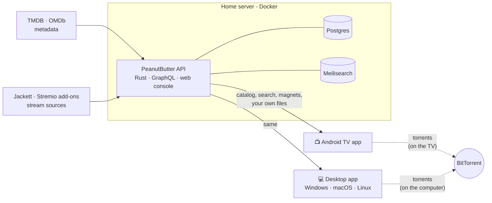

The server is the brain: metadata, search, sources, pairing and updates. The apps do the playing. Files from your media folder stream from the server with byte-range seeking. Torrents are downloaded by the app itself (libtorrent), so the server never stores or shares them.

| Folder | What | Read more |
|---|---|---|
| [`backend/`](backend/) | The server: Rust, Axum, GraphQL, Postgres, Meilisearch | [backend/README.md](backend/README.md) |
| [`android-native/`](android-native/) | Android TV app, in Kotlin | [android-native/README.md](android-native/README.md) |
| [`frontend/`](frontend/) | Desktop app (Flutter) for Windows, macOS, Linux and web | [frontend/README.md](frontend/README.md) |
| [`docs/`](docs/) | Server install and Docker guides | [SERVER.md](docs/SERVER.md) · [DOCKER.md](docs/DOCKER.md) |
| [`scripts/`](scripts/) | Build, packaging and install helpers | |
| [`packaging/`](packaging/) | Installer configs and the update-signing public key | |

---

## 🔧 Configuration

Everything has a sensible default. Most settings, including API keys, Jackett, add-ons, subtitles and languages, can be changed in the console without a restart.

<details>
<summary><b>All environment variables</b></summary>
<br>

| Variable | What it does |
|---|---|
| `PUBLIC_URL` | **The address apps use to reach the server** (LAN IP or domain). Set this. |
| `ADMIN_PASSWORD` | First console password. Empty means one is generated and logged. `ADMIN_PASSWORD_RESET=1` forces it once. |
| `TMDB_API_KEY` · `OMDB_API_KEY` | Metadata. TMDB is the important one; OMDb adds IMDb and Rotten Tomatoes scores. |
| `MEDIA_PATH` | Your own media folder, mounted into the container |
| `JACKETT_URL` · `JACKETT_API_KEY` | Jackett, if you prefer env vars over the console |
| `OPENSUBTITLES_API_KEY` · `WYZIE_API_KEY` | Subtitle providers |
| `PREFERRED_LANGUAGES` | Audio and subtitle languages to prefer (e.g. `en,hi`) |
| `API_KEY` | A fixed pairing code for the admin device, re-opened for 15 minutes on each boot |
| `CORS_ORIGINS` | Extra browser origins allowed to call the API (comma-separated) |
| `SYNC_CRON_POPULAR` · `SYNC_CRON_STALE` | Metadata sync schedule |
| `UPDATES_ENABLED` · `UPDATE_CHECK_HOURS` | App update mirroring (on by default) |
| `DATABASE_URL` · `MEILI_URL` · `MEILI_MASTER_KEY` | Set by the compose files; change only if you run your own |
| `BIND_ADDR` · `RUST_LOG` | Listen address and log filter |

[`.env.example`](.env.example) is a starting point for local development; [docs/SERVER.md](docs/SERVER.md) covers server-only settings such as auto-update.

</details>

---

## 🔐 Security at a glance

- **Pairing:** a 6-digit code works for 15 minutes and is traded for a long random device key. The server stores only the key's hash. Wrong codes are rate-limited per client and server-wide.
- **Console:** argon2-hashed password, revocable sessions, and refusal of form posts from other sites.
- **App updates:** installers are listed in a manifest signed with an Ed25519 key that only CI holds. The server and the apps both check the signature and each file's hash, and the apps never install an older version.
- **Torrents:** never stored on the server. The server won't fetch arbitrary links for clients.

<details>
<summary><b>Server updates and network exposure</b></summary>
<br>

- **Server updates** are *not* signature-checked. The console has Watchtower pull `ghcr.io/peanutbutterorg/peanutbutter-api:stable` (by default), so you're trusting GitHub's container registry and this repo's CI. For tighter control, pin a version tag in your compose file and update by hand.
- **Network:** the database, search and updater containers aren't exposed outside Docker. For access from outside your home, put HTTPS in front of port 3001 with a reverse proxy.

</details>

---

## 🔨 Developing

```bash
# Server: Postgres + Meilisearch in Docker, API on the host
docker compose up -d postgres meilisearch
cp .env.example .env                  # then fill in TMDB_API_KEY etc.
cd backend && cargo run

# Desktop app
cd frontend && flutter pub get && flutter run -d macos   # or linux / windows / chrome

# Android TV app
cd android-native && ./gradlew :tv:assembleAppDebug
./scripts/update-apps.sh --tv         # build and install on a TV over adb
```

Tests: `cd backend && cargo test` · `cd frontend && flutter analyze && flutter test` · `cd android-native && ./gradlew test`.

Design tokens (colours, type, spacing) live in [`design/tokens.json`](design/tokens.json); `python3 scripts/gen-design-tokens.py` writes them out for the desktop app, the TV app, and the docs.

<details>
<summary><b>How releases are cut</b></summary>
<br>

Releases are cut by merging, not by hand:

1. In your pull request, bump `version` in `backend/Cargo.toml` (one "Server 0.x.y" commit).
2. Merge it into `main`.
3. The [auto-tag workflow](.github/workflows/auto-tag.yml) tags the merge `v0.x.y` and starts both release builds:
   - **Backend & Docker** publishes `ghcr.io/peanutbutterorg/peanutbutter-api:stable`, `:latest` and `:0.x.y`.
   - **Platform Builds** publishes the signed GitHub Release with every installer.

A PR that doesn't bump the version releases nothing, and CI runs only for release tags. Servers then offer the new apps to every paired device, and the console offers the server update.

</details>

---

## 🙏 Please use it responsibly

PeanutButter is a catalog and player. It ships with **no content and no content sources**. You decide what goes in your media folder and which sources you connect, so only use content you have the right to watch.

## 💛 Credits

Metadata from [TMDB](https://www.themoviedb.org/) (this product uses the TMDB API but is not endorsed or certified by TMDB), and IMDb and Rotten Tomatoes scores via [OMDb](https://www.omdbapi.com/). Intro and credits timings come from [TheIntroDB](https://theintrodb.org/). Playback by [libmpv](https://mpv.io/) / [media_kit](https://github.com/media-kit/media-kit), [ExoPlayer](https://developer.android.com/media/media3) and [LibVLC](https://www.videolan.org/vlc/libvlc.html). Torrents by [libtorrent](https://www.libtorrent.org/).

<div align="center">
<br>

<br>
<sub>Made for movie nights at home.</sub>
</div>
